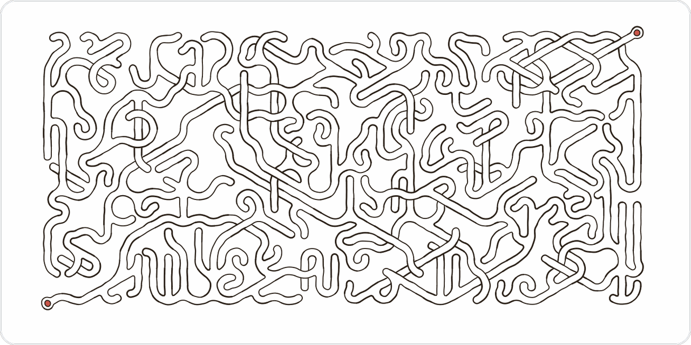

<h1 align="center">Lubra</h1>

<p align="center">Hand-drawn triangle-tile mazes, generated in Rust.</p>

<p align="center">
  <a href="https://maze.do.id.au/?maze=curvy"><b>Play</b></a> &nbsp;·&nbsp;
  <a href="#quick-start">Quick start</a> &nbsp;·&nbsp;
  <a href="#documents">Documents</a> &nbsp;·&nbsp;
  <a href="#how-it-works">How it works</a>
</p>

<p align="center">
  
</p>

Lubra makes **triangle-tile mazes**: winding tracks drawn on a grid of
triangles, in ink, with tracks that pass over and under one another. Every maze
is a single tree, so there is exactly one route from the entrance (bottom left)
to the exit (top right). Play them in the browser at
[maze.do.id.au](https://maze.do.id.au/?maze=curvy).

## Quick start

```bash
make build                                        # build everything
make cli CLI_ARGS="--seed 1 -W 20 -H 12 -o maze"  # draw a maze: cli/maze.svg
make test                                         # run the tests
make                                              # list every task
```

Add `-S` to `CLI_ARGS` for the solution, or `-P` for plain walls; see
[Drawing a maze](docs/drawing.md) for more.

## Documents

| Document | What's in it |
| -------- | ------------ |
| [Drawing a maze](docs/drawing.md) | The command line, the ink and the solution |
| [Settings](docs/settings.md) | Track width and how many crossings there are |
| [Debugging](docs/debugging.md) | The debugging overlay and kink statistics |
| [Design notes](docs/main.pdf) (PDF) | The tiles, the passes that make one maze, and how each fragment is drawn |
| [Shapes](docs/shapes.pdf), [Tiles](docs/tiles.pdf) (PDF) | Every fragment and tile, drawn |
| [WARP.md](WARP.md) | A short guide to the code |

`make doc` builds the PDFs into `docs/` from `typst/`; it needs
[Typst](https://typst.app).

## How it works

The workspace has four crates:

- `lib`: generates, reduces and renders the maze.
- `cli`: the command line.
- `generate`: writes the SVG fragment for every tile shape, and the lookup
  tables, into `lib`.
- `document`: draws every fragment for the design notes.

A maze starts as a grid of random tiles, each picked to fit its neighbours.
Passes then join the tracks into one tree, trim short dead ends, pull apart
tracks drawn against each other and grow branches into the gaps. The
[design notes](docs/main.pdf) go through each step.

---

<p align="center"><sub>Part of <a href="https://daleobrien.github.io/#mazes">Mazes</a> &nbsp;·&nbsp; more at <a href="https://daleobrien.github.io">daleobrien.github.io</a></sub></p>
