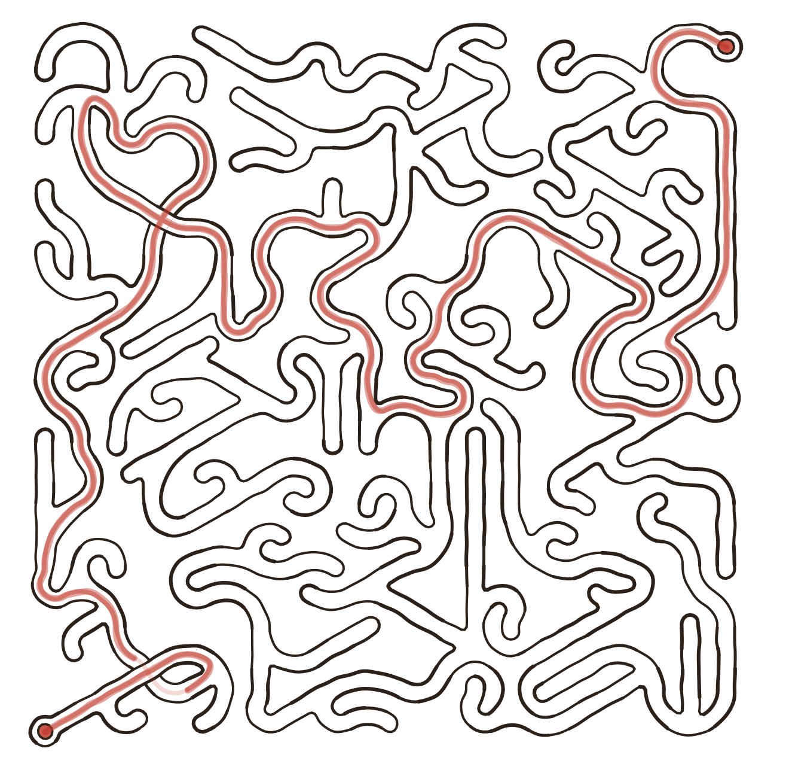

# Drawing a maze

[Back to the README](../README.md)

`make cli` builds the command line and runs it with `CLI_ARGS`. By default it
draws a fixed maze with the debugging overlay ([debugging](debugging.md)); give
your own arguments for a clean one:

```bash
make cli CLI_ARGS="--seed 1 -W 20 -H 12 -o maze"      # cli/maze.svg
make cli CLI_ARGS="--seed 1 -W 20 -H 12 -S -o maze"   # with its solution
make cli CLI_ARGS="--seed 1 -W 20 -H 12 -P -o maze"   # plain, even walls
make cli CLI_ARGS="-W 20 -H 12 -F png -o maze"        # a new maze, as PNG
make cli CLI_ARGS="--help"                            # every option
```

`-W` and `-H` are in columns and rows of tiles; about 1.7 columns per row looks
square. The same `--seed` always gives the same maze; without one, every run
gives a new maze. The file is written in `cli/`.

## Hand-drawn ink

Mazes are drawn by hand, in brown ink, by default: every wall wobbles slightly
and the pen's width wanders, after the ink style of
[maze-rs](https://github.com/daleobrien/maze-rs). The wobble is seeded from the
maze's seed, so a maze always comes out the same. Add `-P` (`--plain`) for even
black walls.

No two tiles look alike in ink, so tiles can't be reused the way plain ones
are: expect files several times bigger (`lib/src/renders/ink.rs`).

## The solution

`-S` (`--solution`) adds the route from the entrance to the exit: pencilled in
red over the ink, gone over twice, and lightly where it passes under another
track; with `-P` it is a plain red line.

`make sample` writes the maze below into `docs/`, with and without its solution
(`SAMPLE_ARGS` sets its size and seed).

<p align="center">
  
</p>
